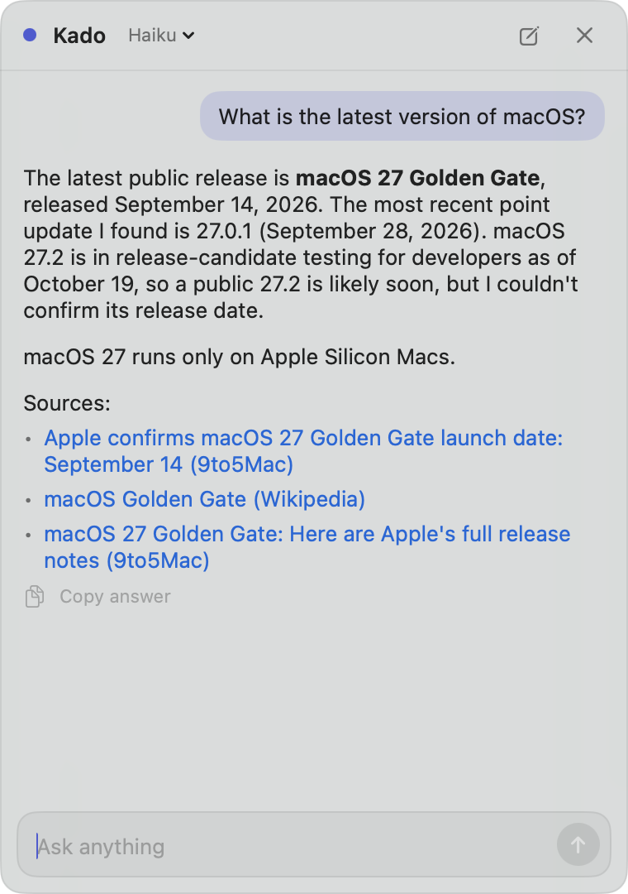

# Kado

A tiny chat that lives in the corner of your Mac screen. Click the bubble (or press `⌃⌥M`), ask a quick question, get an answer, and get back to work.

Kado runs on the [Claude Code](https://code.claude.com) you already have installed, so it needs no API key: it uses your own Claude subscription.



[日本語の説明はこちら](README.ja.md)

> **Kado is an independent project. It is not made by, affiliated with, or endorsed by Anthropic.** "Claude" and "Claude Code" are trademarks of Anthropic.

## Requirements

- macOS 14 or later
- [Claude Code](https://code.claude.com/docs/en/setup) installed and signed in with a plan that includes it (Pro, Max, Team, or Enterprise; the Free plan does not include Claude Code). See [Claude pricing](https://claude.com/pricing).
- Swift 6 (Xcode or the Command Line Tools) to build from source

## Install

1. Sign in to Claude Code once, if you haven't already:

   ```bash
   claude auth login
   ```

2. Build and install. This puts `Kado.app` in `~/Applications` and opens it:

   ```bash
   git clone https://github.com/roadleon/kado.git
   cd kado
   ./build.sh install
   ```

3. To start Kado automatically, right-click the bubble and turn on **Launch at Login**.

## Usage

| Action | How |
|---|---|
| Open / close | Click the bubble, or press `⌃⌥M` |
| Close | `Esc` or `⌘W` |
| Send / new line | `Return` / `Shift + Return` (Return while composing Japanese text confirms the text instead of sending) |
| New chat | The pen button in the header, or `⌘N` |
| Attach images | Paste with `⌘V`, drag and drop onto the chat, or click the capture button (camera icon) to capture part of the screen. Up to 4 images per question |
| Stop an answer | The send button turns into a stop button while Kado answers |
| Change model | Click the model name in the header (starts a new chat) |
| Resize the chat window | Drag any edge or corner. Kado remembers the size. To go back to the default size, choose **Reset Chat Window Size** from the menu |
| Larger text | Click the **aA** button in the header. Click again for the standard size |
| Move the bubble | Drag it. Kado remembers where you put it |
| Menu (model, Launch at Login, Quit) | Right-click the bubble, or use the icon in the menu bar |
| Bubble hidden by mistake | Open Kado again from Spotlight or Finder |

Questions that need current information are answered with a web search, followed by links to the sources. These take a few seconds to about 20 seconds.

Large images are scaled down (longest side 1568 px) before they are sent; Claude would scale them down anyway, so answers don't suffer. Questions with images use more of your usage limits than text-only ones. The first time you use the capture button, macOS asks you to allow Screen Recording for Kado.

If Kado stays closed and unused for 30 minutes, it stops Claude Code in the background to free memory (the next question starts a new chat).

### URL scheme

Launchers such as Raycast and Shortcuts can control Kado with URLs:

- `kado://toggle`, `kado://open`, `kado://close`
- `kado://new` starts a new chat
- `kado://ask?q=...` puts a URL-encoded question in the input field. It does not send it: you press Return. This keeps web pages from sending questions on your behalf.

## How it works

- Kado starts `claude -p` with stream-json input and output and keeps it running for the chat, so follow-up questions start right away.
- Claude Code runs with only two tools: WebSearch and WebFetch. Kado does not load file or shell tools, MCP servers, `CLAUDE.md`, or hooks, and it does not save chat history.
- Kado never reads or stores your Claude credentials. Claude Code signs you in through Anthropic's own flow, and Kado only talks to the unmodified `claude` program.
- The default model is Haiku (effort: medium). Sonnet and Opus run at effort low. Every question counts toward your Claude Code usage limits, and your use is subject to [Anthropic's terms](https://code.claude.com/docs/en/legal-and-compliance).
- Kado looks for `claude` in `~/.local/bin`, `/opt/homebrew/bin`, and `/usr/local/bin`, then asks your login shell. To use a different location:

  ```bash
  defaults write io.github.roadleon.kado claudePath /path/to/claude
  ```

## Customizing the name and look

The name, color, menu bar symbol, icon, bundle ID, and URL scheme come from `brand/public.env`. To build your own copy with a different look, put a `local/brand.env` with the same keys next to it (the `local/` folder is ignored by Git). To build the public version even when `local/brand.env` exists:

```bash
BRAND=public ./build.sh
```

## License

[MIT](LICENSE)
